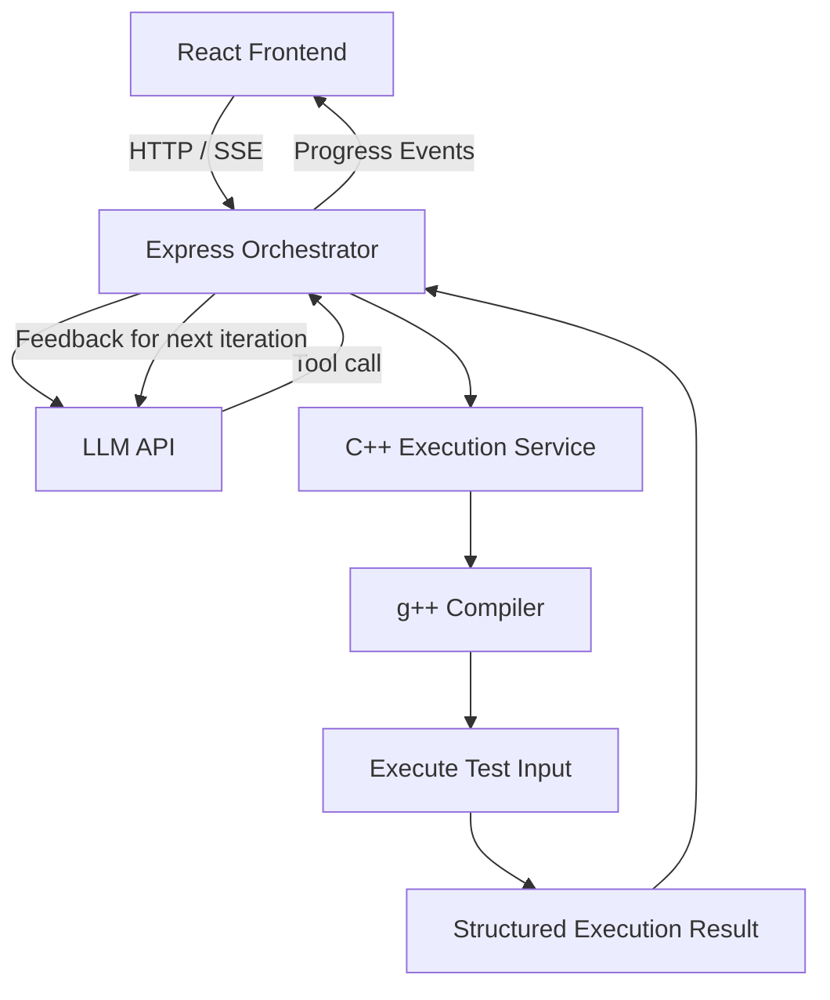

# AutoSWE Sandbox

**An autonomous AI-powered C++ coding agent that writes code, executes it against test cases, analyzes failures, and iteratively attempts to correct its solutions.**

AutoSWE Sandbox combines an LLM-driven reasoning loop, a Node.js orchestration server, a C++20 execution service, and a React frontend to explore how AI agents can automate parts of the software development workflow.

## Overview

Traditional coding assistants generate code and leave testing and debugging to the developer. AutoSWE Sandbox experiments with a more iterative approach: the agent generates a solution, submits it for execution, receives structured feedback, and uses that feedback to attempt a correction.

The project uses a **Reason–Act–Observe** workflow inspired by the ReAct agent pattern.

### Key Features

- **Autonomous problem-solving loop:** Uses an LLM to generate C++20 solutions and decide when another correction attempt is needed.
- **Tool-calling architecture:** Exposes code execution through a structured `execute_cpp_code` tool.
- **Compile-and-run workflow:** Compiles submitted C++ source code using `g++` and executes it with supplied standard input.
- **Feedback-driven correction:** Feeds compilation errors, runtime errors, and incorrect output back into the agent's conversation.
- **Iteration limits:** Configurable maximum number of LLM reasoning iterations.
- **Request pacing:** Serializes LLM requests and enforces a minimum interval between request starts.
- **Real-time progress streaming:** Streams agent events to clients using Server-Sent Events (SSE).
- **Mock execution endpoint:** Provides a mock sandbox endpoint for testing parts of the orchestration workflow without the execution service.
- **Web interface:** Includes a React/Vite frontend for the project.

## Architecture



### Agent Workflow

1. **Receive:** Accept a programming problem and its constraints.
2. **Reason:** Ask the configured LLM to analyze the problem and produce a solution.
3. **Execute:** Receive the tool call and send its C++ source code, standard input, and expected output to the sandbox service.
4. **Observe:** Collect compilation diagnostics, execution results, and output comparisons.
5. **Correct:** If verification fails, append the execution feedback to the conversation so the LLM can attempt a fix.
6. **Terminate:** Stop when the sandbox reports a passing result, the model returns a final response, or the maximum iteration limit is reached.

A passing result indicates that the submitted program matched the supplied expected output for that execution. It does not, by itself, prove correctness for every possible test case.

## Tech Stack

| Component                          | Technology                              |
| ---------------------------------- | --------------------------------------- |
| Agent runtime                      | Node.js, JavaScript (ES modules)        |
| LLM integration                    | OpenAI-compatible Chat Completions API  |
| Backend                            | Express.js                              |
| Streaming                          | Server-Sent Events (SSE)                |
| Execution service                  | Node.js, `g++`, C++20                   |
| Frontend                           | React, Vite                             |
| Container configuration            | Dockerfile                              |
| Alternative sandbox implementation | Go source included in `sandbox/main.go` |

## Project Structure

```text
AutoSWE-Sandbox/
├── agent.js                  # Agent loop, LLM calls, tool handling
├── server.js                 # Express API and SSE orchestration
├── package.json              # Backend dependencies and scripts
├── package-lock.json
├── .gitignore
├── client/
│   ├── package.json
│   ├── index.html
│   └── src/                  # React application source
├── sandbox/
│   ├── sandbox-server.js     # C++ compile-and-run API
│   ├── main.go               # Go sandbox implementation
│   └── Dockerfile
└── repo/
    └── discount.cpp          # Example C++ source file
```

## Getting Started

### Prerequisites

Install the following tools before running the project:

- Node.js and npm
- A working C++ compiler (`g++`) that supports C++20
- An API key for your chosen LLM provider, or a compatible local model endpoint
- Docker, if you intend to use the supplied container configuration

### 1. Clone the repository

```bash
git clone https://github.com/Alien-X-10/AutoSWE-Sandbox.git
cd AutoSWE-Sandbox
```

### 2. Install dependencies

```bash
npm install
```

### 3. Configure environment variables

Create a `.env` file in the project root:

```dotenv
PORT=3001

LLM_BASE_URL=https://api.openai.com/v1
LLM_API_KEY=your_api_key_here
LLM_MODEL=gpt-4o

MAX_ITERATIONS=5
SANDBOX_API_URL=http://localhost:8080/api/v1/execute
```

Replace the example API key with your own. Use the base URL and model name supported by your provider. For a local model, configure `LLM_BASE_URL`, `LLM_API_KEY`, and `LLM_MODEL` appropriately.

**Never commit your `.env` file or expose API keys in frontend code.**

### 4. Start the C++ execution service

In a separate terminal, from the project root:

```bash
node sandbox/sandbox-server.js
```

The service listens on port `8080` and exposes the execution endpoint:

```text
POST /api/v1/execute
```

Ensure `g++` is installed and available on your system's `PATH`.

### 5. Start the orchestrator

In another terminal, from the project root:

```bash
npm start
```

The Express server starts on port `3001` by default.

The root package also provides these scripts:

```bash
npm run dev
npm run cli
```

- `npm run dev` starts the Node.js server in watch mode.
- `npm run cli` runs the agent's command-line smoke test.

The frontend is located in `client/`. Its development script should be reviewed before use because the current script configuration needs correction to avoid recursively invoking itself.

## API Endpoints

| Method | Endpoint                       | Purpose                                                  |
| ------ | ------------------------------ | -------------------------------------------------------- |
| `GET`  | `/api/health`                  | Returns service status and configuration information     |
| `POST` | `/api/agent/stream`            | Starts an agent run and streams progress events over SSE |
| `GET`  | `/api/agent/stream?prompt=...` | Alternative streaming endpoint for browser-based testing |
| `POST` | `/api/v1/mock-execute`         | Runs mock execution logic for workflow testing           |
| `POST` | `/api/v1/execute`              | Compiles and executes C++ source code                    |

### Example: Start an Agent Run

Send a POST request to `http://localhost:3001/api/agent/stream` with a JSON body:

```json
{
  "prompt": "Write a C++20 program that reads N integers and prints their maximum subarray sum. Include a test input and its expected output."
}
```

Example using `curl`:

```bash
curl -N -X POST http://localhost:3001/api/agent/stream \
  -H "Content-Type: application/json" \
  -d "{\"prompt\":\"Write a C++20 solution for maximum subarray sum. Include test input and expected output.\"}"
```

The response is a stream of SSE events representing agent initialization, reasoning, tool calls, sandbox results, errors, and completion.

### Example: Execute C++ Directly

Send a POST request to `http://localhost:8080/api/v1/execute`:

```json
{
  "source_code": "#include <iostream>\nusing namespace std;\nint main(){int a,b;cin>>a>>b;cout<<a+b<<'\\n';}",
  "stdin": "2 3\n",
  "expected_output": "5"
}
```

The service returns structured information including the pass/fail result, status, exit code, standard output, standard error, and execution time.

## Configuration

| Variable          | Purpose                       | Default                                |
| ----------------- | ----------------------------- | -------------------------------------- |
| `PORT`            | Orchestrator HTTP port        | `3001`                                 |
| `LLM_BASE_URL`    | LLM API base URL              | OpenAI API URL                         |
| `LLM_API_KEY`     | LLM provider API key          | Placeholder fallback in code           |
| `LLM_MODEL`       | Model identifier              | `gpt-4o` in the agent                  |
| `MAX_ITERATIONS`  | Maximum agent-loop iterations | `5`                                    |
| `SANDBOX_API_URL` | Execution service URL         | `http://localhost:8080/api/v1/execute` |

The agent currently uses a fixed request-start interval in its rate limiter. This is intended to pace requests, not to replace provider-side quota enforcement.

## Current Limitations

- Verification currently compares program output with a supplied expected output; it is not a comprehensive judge with hidden test suites.
- A successful test run does not guarantee algorithmic correctness across all inputs.
- The execution service requires additional hardening before it should accept untrusted code from public users. A separate process or container alone does not guarantee secure isolation.
- The React frontend's development script needs correction before the complete frontend workflow can be considered ready.
- The Go implementation and Docker configuration are included, but their production readiness and integration should be verified separately.

## Security Considerations

This project executes generated C++ code. **Do not expose the execution endpoint to the public internet in its current form.**

Before production use, implement and test:

- Strong execution isolation with a dedicated, restricted sandbox.
- CPU, memory, process-count, and execution-time limits.
- Restricted filesystem and network access.
- Request authentication, validation, and rate limiting.
- Safe temporary-file handling and cleanup.
- Protection against abuse and resource exhaustion.

## Future Improvements

- [ ] Add hidden and multi-case test suites.
- [ ] Strengthen execution isolation and resource limits.
- [ ] Add structured test-case generation and regression testing.
- [ ] Improve the frontend's real-time execution and debugging experience.
- [ ] Add automated tests and CI workflows.
- [ ] Add observability, execution logs, and cost tracking.
- [ ] Support configurable model providers and execution policies.

## Contributing

Contributions, bug reports, and suggestions are welcome. Open an issue to discuss a substantial change before submitting a pull request.

## License

No explicit repository license has been established in this README. Add a `LICENSE` file and update this section before distributing the project under an open-source license.

---

**Built as an exploration of LLM agents, tool calling, iterative debugging, and C++ execution workflows.**
